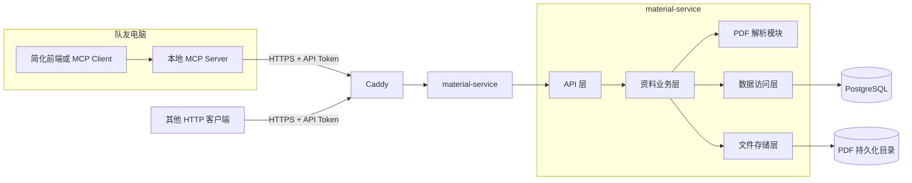
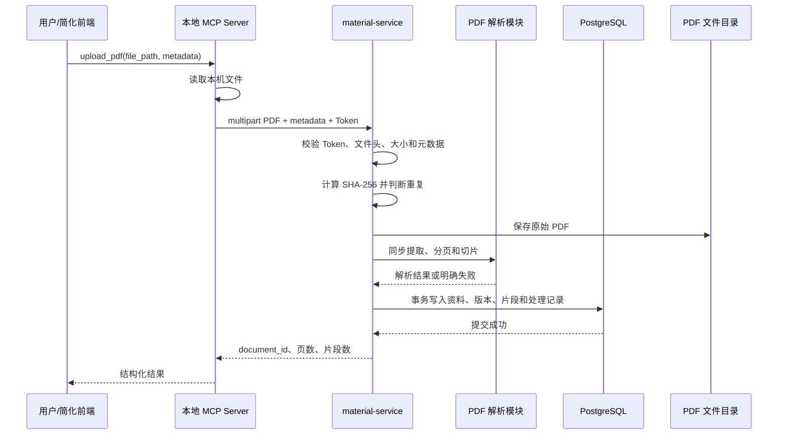

# 高数共享资料库、PDF 解析与 MCP POC 设计规格

> 日期：2026-09-27  
> 状态：待用户审阅  
> 适用范围：南京理工大学高等数学“多重积分”公共资料 MVP

## 1. 文档目的

本文确定第一版共享资料库的系统边界、数据流、接口、数据模型、失败语义、部署方式和验收证据。它用于指导后续实施，不代表数据库、服务、MCP 或服务器部署已经完成。

第一版只证明以下闭环：

```text
本机选择文本型 PDF
→ 本地 MCP 上传
→ 服务器同步解析与切片
→ PostgreSQL 保存
→ MCP 或普通 HTTP API 检索
→ 返回原始片段、资料名称和页码
```

第一版不使用 RAG、向量检索或模型生成教学答案。检索结果直接展示数据库保存的候选片段，重点验证文件是否成功上传、解析、入库和查回。

## 2. 已确认范围

### 2.1 第一版包含

- 公共高等数学“多重积分”资料；
- 只接收能够直接提取文字的 PDF；
- 原始 PDF 持久化保存；
- PDF 文本提取、分页、切片和质量标记；
- PostgreSQL 保存资料、版本、片段、处理记录和客户端凭据；
- 按课程、单元、资料和关键词列出或检索资料；
- 返回资料来源、原文件引用、页码和处理状态；
- 本地 MCP POC；
- 不经过 MCP 的普通 HTTP API；
- Windows 本地开发；
- Docker 打包并部署到 SH 服务器；
- `materials.for-fdd.xyz` 公网 HTTPS 入口；
- 一个项目级共享 API Token；
- 正常链路和失败链路的可复现实验证据。

### 2.2 第一版不包含

- 扫描 PDF、OCR、图片内容识别；
- DOCX、PPTX、图片或网页资料；
- RAG、Embedding、向量检索和向量数据库；
- 自然语言讲解、数学推理或复杂 Agent；
- 私人资料、学生身份、权限隔离和贡献审核；
- 任意 SQL；
- 修改、替换、删除资料；
- 后台异步队列和独立解析 Worker；
- 完整用户系统、OAuth、复杂角色和重型安全平台；
- 自动定时备份。

## 3. 核心术语与边界

### 3.1 MCP 的职责

MCP 是工具调用协议和本地适配层，不是数据库连接协议。第一版 MCP Server 运行在使用者本机，负责：

- 接收工具调用；
- 读取本机 PDF 路径；
- 调用远程 HTTPS 业务 API；
- 把结构化结果返回给 MCP Client 或简化 Agent。

MCP 不直接连接 PostgreSQL，不执行任意 SQL，也不在服务器上读取调用者电脑的本地路径。

### 3.2 `material-service` 的职责

`material-service` 是唯一业务入口，负责：

- API Token 校验；
- PDF 接收与基本验证；
- 原始文件存储；
- SHA-256 去重；
- 资料、版本和处理记录管理；
- 同步调用 PDF 解析模块；
- 事务性写入片段；
- 列表和候选片段查询；
- 把数据库异常转换成稳定的业务错误。

队友可以通过本地 MCP 或普通 HTTP 客户端访问该服务。任何队友均不获得公网 PostgreSQL 连接信息。

### 3.3 PDF 解析模块的职责

解析模块第一版作为 `material-service` 内部模块运行，不是独立进程。它负责：

- 使用 PyMuPDF 打开文本型 PDF；
- 逐页提取文字；
- 检测无可用文字的扫描型 PDF；
- 以页面和段落边界优先、最大约 1500 字符为限制生成片段；
- 保留起止页码、片段顺序和解析器版本；
- 生成公式、图片和文本质量标记所需的初步信息。

当同步处理无法稳定满足 120 秒超时或多人上传阻塞服务时，才将此模块拆成真正的异步 Worker。

## 4. 总体架构



### 4.1 上传数据流



### 4.2 查询数据流

```text
调用者提交课程、单元、关键词、可选 document_id 和 limit
→ material-service 校验参数
→ 使用参数化查询访问可检索版本
→ 返回候选片段、资料标题、页码、来源与分数类型
→ MCP 原样返回结构化 JSON
```

## 5. 项目结构

```text
frontend-poc/          简单演示页面或调用脚本
mcp-server/            队友本机运行的 MCP Server
material-service/      服务器业务 API、解析、文件和数据库逻辑
migrations/            Alembic 数据库迁移
deploy/                Docker Compose、Caddy 示例和部署说明
tests/                 单元、接口、数据库和 MCP 冒烟测试
docs/                  规格、执行计划、接口契约和验收记录
.env.example           配置名和示例，不含真实密钥
```

实现语言与主要组件：Python、FastAPI、MCP Python SDK、PyMuPDF、PostgreSQL、SQLAlchemy、Alembic、pytest、Docker Compose。Caddy 使用 SH 服务器现有容器，不在本项目中重复占用 80/443 端口。

## 6. 文件、资料、版本与任务标识

不同对象使用不同 ID：

| 标识 | 含义 |
|---|---|
| `file_id` | 一份实际上传的原始 PDF 文件 |
| `document_id` | 一份逻辑资料，例如《多重积分讲义》 |
| `document_version_id` | 逻辑资料的具体版本 |
| `chunk_id` | 某个版本生成的文本片段 |
| `ingestion_run_id` | 某次同步导入尝试及其结果 |

文件名不作为唯一标识。服务对文件内容计算 SHA-256：

- 同一幂等请求重试：返回第一次请求的结果；
- 相同哈希再次上传：复用原始文件对象，不重复保存文件；
- 相同文件名但哈希不同：视为不同文件；
- 哈希相同但业务元数据不同：允许创建不同逻辑资料，但复用文件对象；
- 第一版不开放版本替换接口，但数据模型保留版本关系。

## 7. 数据模型

### 7.1 `stored_files`

| 字段 | 说明 |
|---|---|
| `id` | `file_id` |
| `sha256` | 文件内容哈希，唯一索引 |
| `original_name` | 净化后的原文件名 |
| `storage_key` | 与操作系统无关的逻辑对象键 |
| `size_bytes` | 文件大小 |
| `mime_type` | 服务端检测后的类型 |
| `created_at` | 上传时间 |

数据库不保存 `D:\...` 或 `/home/...` 形式的永久绝对路径。

### 7.2 `documents`

| 字段 | 说明 |
|---|---|
| `id` | `document_id` |
| `title` | 资料标题 |
| `course` | 第一版固定为高等数学，但仍显式保存 |
| `unit` | 第一版为多重积分 |
| `source_name` | 资料提供者或出处 |
| `source_type` | 第一版使用 `course_material` |
| `author` | 可空 |
| `publication_year` | 可空 |
| `description` | 可空 |
| `applicable_school` | 可空；表示适用学校 |
| `is_official_source` | 是否为学校官方来源，默认 false |
| `current_version_id` | 当前可检索版本 |
| `created_at` | 创建时间 |

`applicable_school` 与 `is_official_source` 必须分开，禁止把“适用于南京理工大学”自动解释为“南京理工大学官方发布”。

### 7.3 `document_versions`

| 字段 | 说明 |
|---|---|
| `id` | `document_version_id` |
| `document_id` | 所属逻辑资料 |
| `file_id` | 使用的原始 PDF |
| `version_number` | 资料内递增版本号 |
| `processing_status` | 技术处理状态 |
| `publication_status` | 公共使用审批状态 |
| `searchable` | 是否允许检索 |
| `parser_version` | 解析器及切片规则版本 |
| `page_count` | PDF 页数 |
| `chunk_count` | 片段数 |
| `created_at` | 创建时间 |

第一版上传由管理员共享 Token 发起，机器质量标记完成后直接设为 `approved`；同时保留人工抽查记录要求。处理失败的版本必须保持 `searchable=false`。

### 7.4 `document_chunks`

| 字段 | 说明 |
|---|---|
| `id` | `chunk_id` |
| `document_version_id` | 所属资料版本 |
| `chunk_index` | 版本内稳定次序，联合唯一 |
| `page_start` / `page_end` | 原 PDF 页码范围 |
| `text` | 片段正文 |
| `heading_path` | 可空标题层级 |
| `content_type` | `body` 等内容类型 |
| `text_quality` | `complete`、`partial` 或 `unusable` |
| `formula_status` | `preserved`、`possibly_missing` 或 `missing` |
| `has_figure` | 页内是否可能存在图示 |
| `created_at` | 创建时间 |

首批公共资料必须人工抽查公式、积分上下限和区域图。质量标记不阻止所有片段入库，但 `unusable` 片段不得进入普通候选查询；`partial` 片段必须在返回中携带风险标记。

### 7.5 `ingestion_runs`

| 字段 | 说明 |
|---|---|
| `id` | `ingestion_run_id` |
| `idempotency_key` | 调用方生成的幂等键，唯一 |
| `file_id` / `document_id` | 可空关联 |
| `status` | `running`、`success` 或 `failed` |
| `stage` | 失败或当前阶段 |
| `error_code` | 稳定错误码，可空 |
| `error_message` | 脱敏后的诊断信息，可空 |
| `duration_ms` | 处理耗时 |
| `created_at` / `finished_at` | 起止时间 |

### 7.6 `api_clients`

第一版只使用一个项目级共享 Token。仓库不保存真实 Token；服务端保存 Token 的哈希或通过环境变量提供预期值。表结构可保留 `client_name`、`token_hash`、`enabled`、`created_at` 和 `last_used_at`，但不扩展为完整用户系统。

## 8. 处理状态与原子性

同步导入阶段：

```text
validating_file
→ storing_file
→ extracting
→ chunking
→ validating_content
→ writing_database
→ success
```

成功标准：原件保存、文本提取、切片、质量检查以及资料/版本/片段事务写入全部完成。

失败规则：

- 数据库事务失败时回滚资料、版本和片段写入；
- 已保存但未关联成功的原始文件作为孤立文件记录，后续由维护命令清理；
- 处理失败必须写入 `ingestion_runs`；
- 失败版本永远不参与检索；
- 同一 `idempotency_key` 重试返回已有成功结果，或明确返回原失败记录；
- 超时不能造成重复资料或部分可检索片段。

## 9. HTTP API 契约

所有业务响应使用 JSON；PDF 上传请求本身使用 `multipart/form-data`，响应仍为 JSON。所有 `/v1` 业务接口使用 `Authorization: Bearer <token>`。

### 9.1 `POST /v1/materials/ingest`

同一个 multipart 请求提交 PDF 和元数据，服务同步完成解析和入库。必填字段：

```json
{
  "title": "多重积分讲义",
  "course": "高等数学",
  "unit": "多重积分",
  "source_name": "课程资料整理",
  "source_type": "course_material",
  "idempotency_key": "客户端生成的 UUID"
}
```

可选字段：`author`、`publication_year`、`description`、`applicable_school`、`is_official_source`。

成功响应：

```json
{
  "status": "success",
  "document_id": "doc_...",
  "document_version_id": "docv_...",
  "file_id": "file_...",
  "page_count": 42,
  "chunk_count": 87,
  "duplicate_file": false,
  "searchable": true
}
```

### 9.2 `GET /v1/materials`

可选查询参数：`course`、`unit`、`limit` 和游标。返回资料标题、当前版本、来源、页数、片段数和创建时间，不返回全部正文。

### 9.3 `POST /v1/materials/search`

请求：

```json
{
  "query": "交换积分次序",
  "course": "高等数学",
  "unit": "多重积分",
  "document_id": null,
  "limit": 10
}
```

第一版使用 PostgreSQL 全文/关键词检索与元数据过滤。检索策略由 MCP/RAG 负责人后续扩展，但数据库服务必须先提供可解释、可复现的候选查询。调用方不能传 SQL。

成功响应：

```json
{
  "status": "success",
  "items": [
    {
      "chunk_id": "chunk_...",
      "text": "……",
      "document_id": "doc_...",
      "document_title": "多重积分讲义",
      "page_start": 12,
      "page_end": 13,
      "source_name": "课程资料整理",
      "source_type": "course_material",
      "quality_flags": [],
      "score": 0.83,
      "score_type": "full_text_rank"
    }
  ]
}
```

正常无结果：

```json
{
  "status": "not_found",
  "items": []
}
```

### 9.4 健康检查

- `GET /health`：进程存活，不依赖数据库；
- `GET /ready`：检查数据库连接和 PDF 存储目录可写性，不执行破坏性操作。

## 10. MCP 工具契约

本地 MCP Server 提供三个工具：

### 10.1 `upload_pdf`

输入：本机 `file_path`、资料必填元数据和可选元数据。工具读取本机文件，生成幂等键并调用 `/v1/materials/ingest`。

### 10.2 `list_materials`

输入：可选 `course`、`unit` 和 `limit`。调用 `/v1/materials`。

### 10.3 `search_materials`

输入：`query`、可选 `course`、`unit`、`document_id` 和 `limit`。调用 `/v1/materials/search`。

工具输出只返回结构化 JSON，不生成教学回答。MCP SDK 与协议版本必须写入运行证据，不把某一版握手流程当成永久规范。

## 11. 错误语义

HTTP 状态码和业务错误码共同使用。响应统一包含 `status=error`、`error_code`、面向调用方的 `message` 和可用于日志关联的 `request_id`。

| 错误码 | 含义 |
|---|---|
| `UNAUTHORIZED` | Token 缺失或错误 |
| `INVALID_ARGUMENT` | 元数据、limit 或请求结构非法 |
| `FILE_TOO_LARGE` | 超过 50 MB |
| `TOO_MANY_PAGES` | 超过 300 页 |
| `NOT_A_PDF` | 文件头或解析结果表明不是 PDF |
| `PDF_CORRUPTED` | PDF 损坏或无法打开 |
| `PDF_TEXT_NOT_EXTRACTABLE` | 未提取到可用文字，通常为扫描件 |
| `PDF_PROCESSING_TIMEOUT` | 同步处理超过 120 秒 |
| `DATABASE_UNAVAILABLE` | 数据库连接或执行失败 |
| `STORAGE_UNAVAILABLE` | PDF 存储目录不可写或空间不足 |
| `INTERNAL_ERROR` | 未归类的服务端错误，不返回内部堆栈 |

“正常无结果”不是错误，必须返回 `status=not_found`；不得把数据库故障伪装成资料库无结果。

## 12. 限制与配置

默认值全部通过环境变量配置：

| 配置 | 默认值 |
|---|---|
| 单文件大小 | 50 MB |
| PDF 最大页数 | 300 |
| 同步处理超时 | 120 秒 |
| 检索默认返回 | 10 条 |
| 检索最大返回 | 50 条 |
| 片段最大长度 | 约 1500 字符 |

日志不得记录 PDF 正文、完整 API Token、数据库密码或完整异常堆栈。第一版不制作复杂安全系统，但必须保留 Token 校验、文件类型校验、参数限制和基本请求限速。

## 13. SH 服务器部署设计

2026-09-27 只读核查结果：

| 项目 | 已核查事实 |
|---|---|
| SSH 别名 | `SH` |
| 系统 | Ubuntu 24.04.4 LTS，x86_64 |
| Docker | Server 29.1.3 |
| Docker Compose | 2.40.3 |
| Caddy | `caddy:2.8-alpine` 容器 |
| 80/443 | 已由现有 Caddy 容器监听 |
| Caddyfile | 宿主机 `/opt/for-mygirl/shared/prod/Caddyfile` |
| 根磁盘 | 40 GB，总体可用约 19 GB |

### 13.1 部署单元

本项目使用独立 Compose 项目，至少包含：

- `material-service`；
- 项目专用 PostgreSQL；
- PostgreSQL 数据卷；
- PDF 原件持久化卷或宿主机目录。

`material-service` 不直接暴露公网。现有 Caddy 增加 `materials.for-fdd.xyz` 站点，并通过双方共享的外部 Docker 代理网络访问服务。实施时必须先备份 Caddyfile、验证配置，再 reload；不得重建或中断现有 `for-mygirl` 服务。

### 13.2 配置

仓库只提供 `.env.example`。真实环境至少配置：

- `DATABASE_URL`；
- PostgreSQL 数据库名、用户和密码；
- `MATERIAL_SERVICE_API_TOKEN`；
- `MATERIAL_STORAGE_ROOT`；
- 文件、页数、超时、片段和查询限制；
- `MATERIAL_SERVICE_BASE_URL=https://materials.for-fdd.xyz`。

### 13.3 部署顺序

```text
只读核查现有服务
→ 准备独立目录和环境配置
→ 启动项目 PostgreSQL
→ 执行迁移
→ 启动 material-service
→ 在服务器内部验证 /health 和 /ready
→ 备份并校验 Caddyfile
→ 添加 materials.for-fdd.xyz 反向代理
→ Caddy 配置校验与 reload
→ 公网 HTTPS 冒烟
→ 另一台机器运行本地 MCP 冒烟
```

每个阶段必须有独立验收和回滚点，不能因本项目部署中断现有站点。

## 14. 数据保留与已接受风险

第一版不实现自动或手工备份流程，这是用户明确接受的范围选择。执行结果不得声称数据可恢复。

风险包括：

- PostgreSQL 卷损坏会丢失资料关系和片段；
- PDF 卷损坏会丢失原始来源文件；
- 仅保留其中一方无法完整恢复资料库；
- SH 根磁盘当前可用空间有限，上传前必须观察剩余容量；
- 不做删除接口意味着误传文件需要管理员在服务端处理，不能通过 MCP 自助删除。

## 15. 测试与验收

### 15.1 自动测试

- 文件头、扩展名、大小和页数校验；
- 文本 PDF 逐页提取；
- 扫描 PDF 返回 `PDF_TEXT_NOT_EXTRACTABLE`；
- 按页/段落切片及页码保留；
- 哈希去重和幂等请求；
- 数据库事务回滚；
- `unusable` 片段不参与检索；
- 列表、检索和正常无结果；
- 数据库不可用与无结果错误语义分离；
- Token 校验；
- MCP 工具到 HTTP API 的参数和错误映射。

### 15.2 POC 验收矩阵

| 场景 | 预期证据 |
|---|---|
| 上传正常文本型 PDF | 返回 `document_id`、页数和片段数 |
| 重新上传同一 PDF | 命中 SHA-256，文件和片段不重复 |
| 上传扫描 PDF | 返回 `PDF_TEXT_NOT_EXTRACTABLE` |
| 上传伪装 PDF | 返回 `NOT_A_PDF` |
| 查询存在关键词 | 返回原文、资料名、来源和页码 |
| 查询不存在关键词 | `status=not_found` 且 `items=[]` |
| 数据库不可用 | 返回 `DATABASE_UNAVAILABLE` |
| Token 错误 | 返回 `UNAUTHORIZED` |
| 另一台机器运行 MCP | 通过公网 HTTPS 完成上传和检索 |
| 服务重启 | 已导入资料仍可检索 |

### 15.3 证据要求

最终验收材料至少包含：

- 所用 Python、PostgreSQL、PyMuPDF、MCP SDK 和协议版本；
- 数据库迁移结果；
- 自动测试命令和完整摘要；
- 一次正常上传与检索的请求、响应和关联日志；
- 扫描 PDF、伪装 PDF、无结果、数据库故障和错误 Token 的实际响应；
- Caddy 配置校验与公网 HTTPS 请求；
- 另一台机器运行 MCP 的调用结果；
- 已验证、未验证和已知风险清单。

## 16. 完成定义

只有满足以下条件，才能称第一版 POC 完成：

1. 数据模型通过迁移创建，服务重启后数据仍存在；
2. 正常文本型 PDF 能同步上传、解析、切片并进入检索；
3. 片段能够回溯到具体资料和 PDF 页码；
4. 相同文件和相同请求不会产生失控的重复数据；
5. MCP 三个工具均通过真实远程 API 工作；
6. 普通 HTTP 客户端不依赖 MCP 也能完成同等操作；
7. 正常无结果与系统故障能够区分；
8. 扫描 PDF、伪装 PDF、Token 错误和数据库故障有实际失败证据；
9. `materials.for-fdd.xyz` 的 HTTPS 调用通过；
10. 部署未中断 SH 上已有 Caddy 和 `for-mygirl` 服务；
11. 文档明确记录没有实现 OCR、RAG、私人资料、删除、异步 Worker 和备份。

